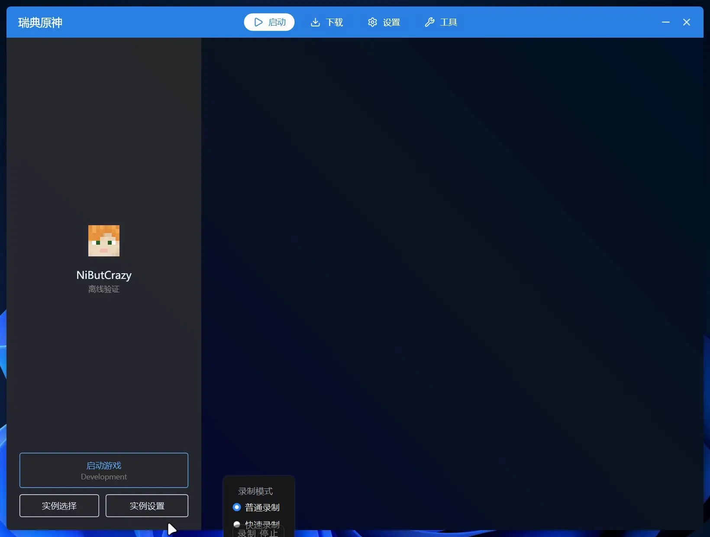
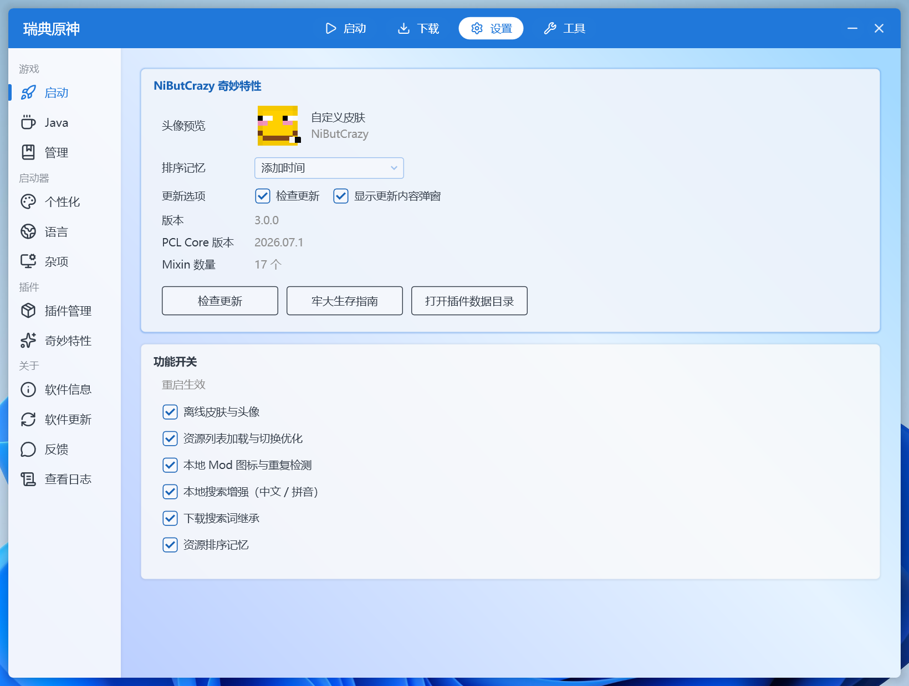

<p align="center">
  
</p>

<h1 align="center">NiButCrazy 奇妙特性</h1>

<p align="center">
  <em>PCL Nex 的 Mixin 插件：资源列表性能优化、本地 / 离线模组支持、离线皮肤与搜索增强。</em>
</p>

<p align="center">
  <a href="https://github.com/NiButCrazy/NiButCrazy-WonderfulFeatures/releases"></a>
  <a href="https://github.com/PCL-Nex-Developer/PCL2-Nex"></a>
</p>

<p align="center">当前版本：<b>3.0.0</b></p>

## 效果预览

模组列表加载与筛选切换效果对比：

<table align="center">
  <tr>
    <td align="center"><b>优化前</b><br/></td>
    <td align="center"><b>优化后</b><br/></td>
  </tr>
</table>

## 目录

- [效果预览](#效果预览)
- [功能特性](#功能特性)
- [本地搜索规则](#本地搜索规则)
- [安装](#安装)
- [自定义离线皮肤](#自定义离线皮肤)
- [配置](#配置)
- [构建](#构建)
- [开发说明](#开发说明)
- [市场发布](#市场发布)

## 功能特性

### 资源列表

- **加载与分帧**：首批 13 个同步显示，剩余项分帧创建；加载期间筛选和排序显示「统计中 / 排序：排序中」，避免空白列表和错误计数。
- **加载期间隐藏滚动条**：分批插入时避免滚动条长度/位置变化造成抖动，全部插入完成后再恢复。
- **页面切换缓存**：在模组、资源包、光影包、投影原理图之间切换时，如果目录内容没有变化，直接复用上一次的列表，不再重新扫描并弹出加载动画；下载、启禁用、手动刷新等操作仍会强制重载。
- **筛选切换优化**：全部 / 已启用 / 已禁用 / 可更新这类顺序不变的切换只处理差异项，排序真正改变时才走重排逻辑。
- **排序记忆**：在 Mod 管理页选择排序方式后自动保存，重新加载、切换实例或首次进入时恢复。
- **搜索取消异常修复**：不再反复输出 `CancellationTokenSource has been disposed` 日志。

### 本地与离线模组

- **本地重复 Mod 检测**：「重复」筛选不再只依赖联网匹配到的资源项目，还会按 jar 内解析出的 `modId` 分组，未收录或联网失败的本地 Mod（如两份不同版本的同一个 Mod）也能被发现。
- **本地 Mod 图标**：读取 Forge / NeoForge 的 `mods.toml` / `neoforge.mods.toml` 中的 `logoFile`，后台提取并缓存；在线图标仍然优先。兼容 `[[mods]] #mandatory` 这类带行内注释的段头。

### 搜索与下载

- **下载搜索词继承**：在本地 Mod/资源管理页输入搜索词后点击「下载新资源」，下载页会自动填入并搜索。
- **中文搜索增强**：读取内置的 Mod 翻译库，把「应用能源」这类中文查询转换为公共英文关键词（如 `applied energistics`），避免只锁定到 AE1 而搜不到 AE2。
- **拼音模糊搜索**：支持全拼、首字母和混合写法（如 `yyny`、`yingyongny`、`jixiedl`），只匹配连续子串，避免 `yyy` 这类跳字误匹配；内置 TinyPinyin。
> [!NOTE]
> 该功能处于测试中，可能更新频繁...

### 插件设置页

- **入口位置**：在「设置 → 插件」分类下、「插件管理」之后新增「奇妙特性」，点击打开独立设置页。
- **排序记忆**：直接设置资源管理的默认排序方式，修改后立即保存。
- **头像预览**：显示当前离线档案的头像和皮肤文件名；自定义皮肤支持悬停查看地址、点击复制，换肤后再次进入页面自动刷新。
- **更新选项**：可分别关闭「启动时检查更新」和「更新后显示更新内容弹窗」。
- **功能开关**：按功能组开启或关闭插件 Mixin（离线皮肤与头像、列表优化、本地 Mod、搜索增强、下载搜索词、排序记忆），重启生效。
- **插件信息**：显示当前版本、PCL Core 版本和 Mixin 数量。
- **快捷按钮**：牢大生存指南（打开 GitHub 自述文件）、检查更新、打开插件数据目录。

<p align="center">
  
</p>

### 离线皮肤与头像

- **离线皮肤**：支持本地自定义皮肤；没有自定义皮肤时沿用 PCL 原版的 Steve / Alex 选择。
- **离线换头像**：离线档案的「皮肤与披风 → 修改头像」可以直接选择本地 PNG，不再提示「当前档案不支持修改皮肤！」；离线档案会隐藏「保存皮肤」与「修改披风」，并提供「删除头像」恢复默认皮肤。
- **只读头像逻辑**：重写 `MySkin.Load`，只读取皮肤文件并截取头部区域，绝不写回来源皮肤文件。
- **头像过渡**：头像淡入（360ms），帽子层延迟 60ms；昵称和账号类型同步淡入。
- **启动优化**：启动阶段复用人像缓存并延迟皮肤处理，避免和窗口入场动画抢 UI 线程。
- **刷新隔离**：离线档案刷新头像时只重启离线皮肤加载器，不清空正版 / Authlib 缓存，档案选择列表的头像不会被清空。

## 本地搜索规则

> 错字过滤规则从 `2.1.1` 开始生效。

### 搜索源与权重

| 搜索源 | 权重 |
| --- | --- |
| 名称、文件名、原始名、译名 | 1.0 |
| 描述 | 0.4 |
| 版本、标签 | 0.2 |

拼音别名会附加到名称、文件名、原始名和译名上。

### 拼音搜索

- 按名称中的中文片段生成全拼、首字母和混合别名；
- 支持纯中文和中英混合名称，例如 `应用能源2 (Applied Energistics 2)`；
- 只有查询词是某个拼音别名的**连续子串**时才启用该别名：
  - `yyny`、`yyn`、`yny`、`yy` → 应用能源
  - `yingyong`、`yongneng` → 应用能源
  - `yingyongny`、`jixiedl` → 混合写法
  - `yyy`、`yyx` → 不会因为跳字命中

### 英文 / 中文模糊搜索

- 保留 PCL 原有的模糊匹配：允许跳字、缩写和片段匹配，不要求连续；
- 连续子串命中优先展示；
- `2.1.1` 起增加错字过滤：模糊结果中，查询的每个词必须能在**名称级字段**（名称、文件名、原始名、译名及其拼音别名）中找到全部字符，且重复字符的数量不能超过别名中的数量；
- 描述和标签只参与相似度打分，不能为错字提供依据。

示例：

| 查询 | 结果 |
| --- | --- |
| `apeng` | 可以匹配 `Applied Energistics`（字符都在名称中） |
| `cook` | 不会匹配 `CoFH核心`（名称级没有 `k`） |
| `cook` | 可以匹配 `Cooking for Blockheads` |
| `zngf` | 不会匹配 `懒人厨房`（名称级没有 `z`） |
| `tweaks` | 可以匹配包含该连续子串的描述（精确子串匹配） |

### 排序

- 连续子串命中优先；
- 其余结果按相似度排序，本地最多返回 25 条模糊结果。

## 安装

### 插件市场（推荐）

仓库带有 `pclnexplugin` Topic，启动器的插件市场会自动发现。搜索「NiButCrazy 奇妙特性」，或在「实用」分组中查找。

> 已经能通过 Topic 发现时，不要再手动添加同一个插件的 Manifest 源，否则市场会把同一插件按不同来源显示成多条。

### 一键安装到本地启动器

```powershell
.\install-plugin.ps1
```

默认目标为 `D:\MC\nex\PCL2.exe`，会构建插件、复制到 `PCL/Plugins/` 并自动启用。其他位置可以覆盖：

```powershell
.\install-plugin.ps1 -PclPath "E:\Somewhere\PCL2.exe"
```

### 手动安装

在启动器中打开 **设置 → 插件 → 从本地安装**，选择 `.pclx` 或 `.zip`。

也可以把解压后的目录放到：

```
PCL/Plugins/nibutcrazy.wonderful-features/
├─ plugin.json
├─ mixins.json
├─ changelog.json
├─ assets/icon.png
└─ lib/PCL.Plugin.NiButCrazy.dll
```

然后在插件管理页面启用「NiButCrazy 奇妙特性」。启用状态保存在 `PCL/config.local.v1.json` 的 `PluginEnabledStates`。

## 自定义离线皮肤

> **注意：本插件的离线皮肤只影响启动器内的头像和皮肤预览，不会修改游戏内皮肤。**
> 进游戏后要显示皮肤，仍需要服务端插件（如 SkinsRestorer）或客户端 Mod（如 CustomSkinLoader）配合。

### 在启动器中换肤

选中离线档案 → **皮肤与披风 → 修改头像** → 选择本地 PNG。
插件会复制到下面的 `Skin` 目录并立即刷新头像。

### 手动放置皮肤文件

首次启动后插件会创建：

```
PCL/Plugins/data/nibutcrazy.wonderful-features/
├─ config.json
├─ plugin.log
├─ last-version.txt     ← 上次运行的插件版本
└─ Skin/                ← 必须是单数
   ├─ 说明.txt
   └─ <玩家 ID>.png
```

命名按以下优先级匹配：

1. `<玩家 ID>.png`
2. `<离线 UUID>.png`
3. `default.png`

皮肤要求为 Minecraft 格式的 PNG（64×64 或 64×32）。都没有匹配时，沿用 PCL 原版的 Steve / Alex 选择。

> 1.1.1 之前版本使用 `Skins/`（复数），会把头像缓存写回皮肤文件，表现为「头像变成一坨色块」。
> 新版启动时会自动把旧的 `Skins/` 重命名为 `Skins.old-<时间戳>`，请重新选择一次皮肤。

## 配置

`PCL/Plugins/data/nibutcrazy.wonderful-features/config.json`：

```json
{
  "CompSortMethod": 1
}
```

- `CompSortMethod`：资源管理的默认排序方式。
  - `0` 文件名
  - `1` 资源名（默认）
  - `2` 标签数量
  - `3` 添加时间
  - `4` 文件大小

## 构建

插件需要引用 PCL Nex 的 `PCL.Core.dll` 和 `Plain Craft Launcher 2.dll`。推荐把本仓库与 `PCL2-Nex` 放在同一级目录：

```
<workspace>/
├─ PCL2-Nex/
└─ NiButCrazy-WonderfulFeatures/
```

先在主仓库构建 Release/x64：

```powershell
dotnet build "Plain Craft Launcher 2/Plain Craft Launcher 2.csproj" -c Release -p:Platform=x64
```

然后在本仓库构建：

```powershell
.\build-plugin.ps1
```

主仓库不在默认位置时：

```powershell
.\build-plugin.ps1 -PclBuildDir "D:\Somewhere\PCL2-Nex\Plain Craft Launcher 2\bin\Release\net10.0-windows\win-x64"
```

产物：

```
dist/nibutcrazy.wonderful-features/       可直接放入 PCL/Plugins 的目录
dist/nibutcrazy.wonderful-features.pclx   插件包（推荐分发）
dist/nibutcrazy.wonderful-features.zip    同样内容
```

`.pclx` 与 `.zip` 内容完全相同，前者是 PCL 插件专用扩展名。

## 开发说明

### Mixin 列表

| 目标 | 方式 | 作用 |
| --- | --- | --- |
| `PageLaunchLeft.SkinLegacyLoad` | Overwrite | 自定义皮肤优先，否则沿用原版 Steve / Alex 选择 |
| `PageLoginProfileSkin.Skin_Click` | Inject HEAD | 离线档案的修改头像入口 |
| `MySkin.Load` | Overwrite | 只读皮肤、截取头像、哈希缓存、淡入过渡、启动阶段延迟 |
| `MySkin.RefreshCache` | Inject HEAD | 离线档案刷新只重启离线加载器，不清空皮肤缓存 |
| `PageLoginProfileSkin.Reload` | Inject HEAD | 刷新前隐藏昵称/账号类型；离线档案改菜单文字并隐藏保存皮肤、修改披风 |
| `ModComp.CompProjectsGet` | Inject HEAD | 中文搜索关键词改写 |
| `PageInstanceCompResource.BtnManageDownload_Click` | Inject HEAD | 记录下载搜索词 |
| `PageComp.PageCompControls_Inited` | Inject RETURN | 下载页填充搜索词 |
| `PageInstanceCompResource.BtnSortClick` | Inject HEAD | 标记用户选择排序 |
| `PageInstanceCompResource.SetSortMethod` | Inject TAIL | 保存/恢复排序 |
| `PageInstanceCompResource.SearchRun` | Overwrite | 修复 CTS 释放竞态 |
| `PageInstanceCompResource.GetSearchResult` | Overwrite | 本地 Mod 拼音搜索（全拼 / 首字母 / 混合，连续匹配） |
| `PageInstanceCompResource.LoadUIFromLoaderOutput` | Overwrite | 分批创建 Mod 控件，首批 13 个同步显示，其余分帧；忽略其它资源类型的完成事件 |
| `PageInstanceCompResource.ReloadCompFileList` | Inject HEAD | 目录指纹未变化时复用页面已有列表 |
| `PageInstanceCompResource.RefreshUI` | Overwrite | 增量刷新、子序列快速路径、分帧插入与格式化 |
| `PageInstanceCompResource.RefreshBars` | Inject HEAD | 批次加载期间抑制计数刷新；异步统计结束后校正本地重复项计数与按钮可见性 |
| `PageInstanceCompResource.CanPassFilter` | Inject HEAD | 「重复」筛选补充基于本地 `modId` 的检测 |
| `ModLocalComp.LocalCompFile.GetLogo` | Overwrite | 在线图标优先，缺少时后台解析 Forge/NeoForge `logoFile` |
| `PageSetupLeft.PageSetupLeft_Loaded` | Inject HEAD | 在「插件管理」下方插入「奇妙特性」导航项 |
| `PageSetupLeft.PageGet` | Inject HEAD | 返回插件自己的「奇妙特性」页面 |

### 兼容性

PCL Nex 更新后如果这些方法签名变化，插件会加载失败并被启动器自动禁用，`plugin.log` 中会记录原因。

## 市场发布

- `manifest.json` 位于仓库根目录，声明插件元数据、版本、平台包和 SHA-256。
- Release tag 使用 `v<版本号>`，资产命名 `nibutcrazy.wonderful-features-windows-anycpu.pclx`。
- 发版流程：修改 `plugin.json` 版本 → 在 `changelog.json` 增加对应版本的更新内容 → 构建 → 更新 `manifest.json` 的版本/URL/哈希 → 提交推送 → 创建对应 Release。
- 版本更新后首次启动会读取 `changelog.json` 中当前版本的条目并弹窗；首次安装不弹窗。
- 启动后还会检查市场 `manifest.json`，发现新版本时弹 Toast。
